# Documentação técnica · Portfólio do Tiago

> Site pessoal no estilo **Terminal + Circuito Quântico**, com simulações interativas de física quântica rodando direto no navegador.

| | |
|---|---|
| **Autor** | Tiago Rodrigues · [GitHub](https://github.com/TiagoRodriguesskt) · [LinkedIn](https://www.linkedin.com/in/tiago-rodrigues-0b5417124/) |
| **Versão** | 1.1 |
| **Data** | outubro de 2026 |
| **Tecnologias** | HTML5, CSS3, JavaScript (ES2020+), Canvas 2D |
| **Dependências** | nenhuma biblioteca; apenas Google Fonts |
| **Publicação** | GitHub Pages · `https://tiagorodriguesskt.github.io` |

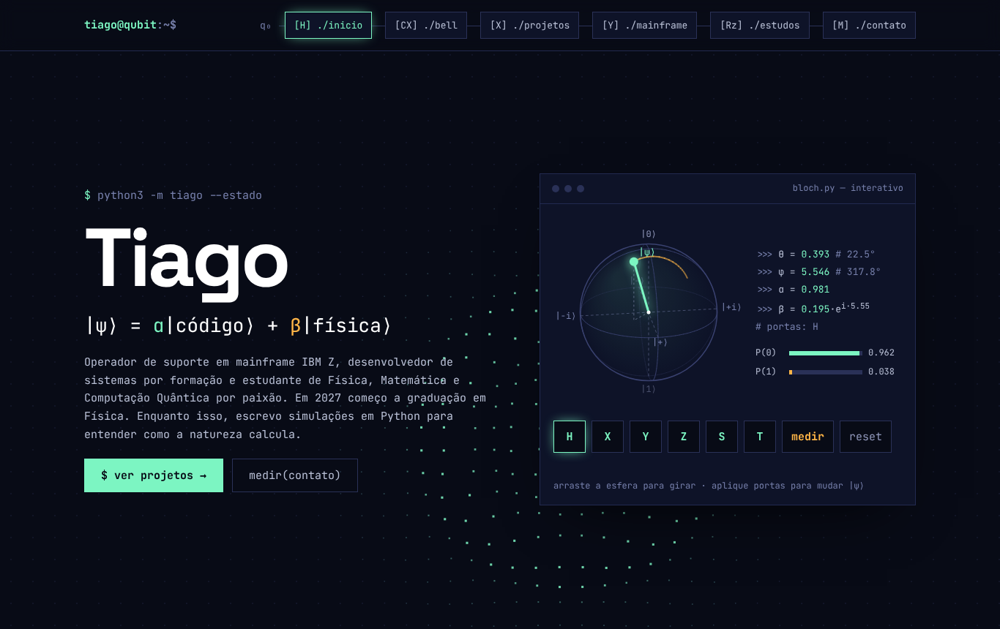

---

## Sumário

1. [Visão geral](#1-visão-geral)
2. [Como o site foi construído](#2-como-o-site-foi-construído)
3. [Decisões técnicas](#3-decisões-técnicas)
4. [Arquitetura](#4-arquitetura)
5. [Estrutura da página](#5-estrutura-da-página)
6. [Módulos do JavaScript](#6-módulos-do-javascript)
7. [A física por trás dos efeitos](#7-a-física-por-trás-dos-efeitos)
8. [Fluxogramas](#8-fluxogramas)
9. [Design system](#9-design-system)
10. [Responsividade](#10-responsividade)
11. [Acessibilidade e desempenho](#11-acessibilidade-e-desempenho)
12. [Testes](#12-testes)
13. [Manutenção: como alterar o site](#13-manutenção-como-alterar-o-site)
14. [Próximos passos](#14-próximos-passos)
15. [Histórico de versões](#15-histórico-de-versões)

---

## 1. Visão geral

### Objetivo

Apresentar o Tiago de forma que una as suas três frentes:

- **Trabalho:** Junior Support Operator em mainframe na CSU Digital S.A desde 2020, com curso IBM Z em andamento.
- **Formação:** técnico em Desenvolvimento de Sistemas, tecnólogo em Análise e Desenvolvimento de Sistemas, pós-graduação em Engenharia de Software e graduação em Física a partir de 2027.
- **Interesse:** Física, Matemática, Computação Quântica e Python.

### Conceito visual

A ideia central é a equação que aparece na abertura:

$$|\psi\rangle = \alpha\,|\text{código}\rangle + \beta\,|\text{física}\rangle$$

O Tiago é apresentado como um **estado em superposição** entre programação e física. Todo o site segue essa metáfora:

- o **terminal** representa o lado de programação (comandos, prompts, fonte monoespaçada);
- o **circuito quântico** representa o lado de física (o menu é um fio de qubit, as seções são portas quânticas);
- as duas cores de destaque reforçam a ideia: **verde-menta** para "código" e **âmbar** para "medição".

### Público

Recrutadores e gestores de tecnologia, professores e colegas da área de Física e Computação Quântica, e a comunidade de mainframe.

---

## 2. Como o site foi construído

O projeto foi feito em etapas curtas, sempre validando cada decisão antes de seguir.

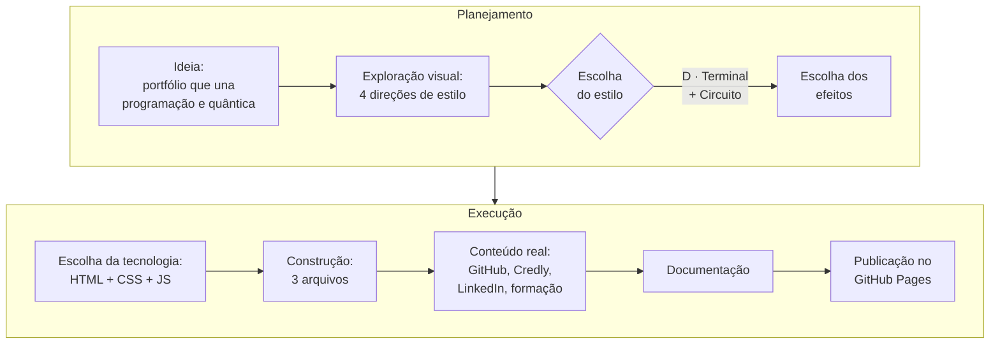

### 2.1 Exploração de estilos

Antes de escrever código, foram desenhadas **quatro direções visuais** para comparação lado a lado:

| Direção | Ideia | Resultado |
|---|---|---|
| A · Terminal Quântico | Tudo em fonte monoespaçada, navegação como comandos | base do lado "código" |
| B · Caderno de Laboratório | Papel quadriculado, serifas, equações | descartada (acadêmica demais) |
| C · Circuito Quântico | Esfera de Bloch e menu como circuito | base do lado "física" |
| **D · Terminal + Circuito** | **União de A e C** | **escolhida** |

### 2.2 Escolha dos efeitos

Das ideias apresentadas, três foram escolhidas e outras foram acrescentadas para reforçar o tema:

| Efeito | Origem |
|---|---|
| Esfera de Bloch interativa | escolhido |
| Circuito de Bell que roda de verdade | escolhido |
| Fundo que reage ao mouse | escolhido |
| Medição com colapso do estado | extra |
| Ondas ao clicar no fundo | extra |
| Ruído no circuito de Bell | extra |
| Nome em superposição + terminal digitando | extra |
| Terminal interativo (easter egg) | extra |

### 2.3 Conteúdo real

Os textos de exemplo foram trocados por dados reais, em ordem:

1. **GitHub:** leitura dos repositórios públicos para escolher os projetos em destaque (`meu_universo_cientifico` e `criptografia_de_cesar`).
2. **Credly:** os 10 badges, com imagens oficiais e link de verificação.
3. **Experiência:** cargo, empresa e atividades na CSU Digital.
4. **LinkedIn e e-mail:** botões de contato.
5. **Formação:** linha do tempo acadêmica.

---

## 3. Decisões técnicas

### 3.1 Por que HTML, CSS e JavaScript puros

| Opção | Avaliação | Decisão |
|---|---|---|
| **HTML + CSS + JS** | O navegador entende nativamente; sem servidor; publica de graça | ✅ escolhida |
| Python com Flask/Django | Exige um servidor rodando o tempo todo, o que complica e custa | ❌ |
| Python com PyScript/Pyodide | Baixa vários megabytes antes de funcionar; site lento para abrir | ❌ (talvez no futuro, numa página à parte) |
| React, Vue, Next.js | Resolvem problemas de sites grandes; complexidade desnecessária aqui | ❌ |

**Papel do Python:** ele aparece nos **projetos** que o site mostra, não no site em si. A matemática da esfera de Bloch e do circuito de Bell foi pensada para ser escrita primeiro em Python (NumPy) e depois traduzida para JavaScript.

### 3.2 Por que Canvas 2D para a esfera de Bloch

A esfera é desenhada à mão com projeção 3D → 2D em vez de usar uma biblioteca 3D (como Three.js). Isso mantém o site **sem dependências**, deixa o arquivo leve e torna a matemática visível no código, o que faz parte da proposta do portfólio.

### 3.3 Por que nenhum framework de CSS

O visual é muito específico (fios, portas, janelas de terminal). Um framework como Bootstrap ou Tailwind seria mais trabalho para desfazer do que para usar. Todas as cores e fontes ficam centralizadas em variáveis CSS (`:root`), o que dá a mesma facilidade de manutenção.

---

## 4. Arquitetura

### 4.1 Arquivos

```text
Portifólio_Tiago/
├── index.html          estrutura e todos os textos
├── style.css           visual: cores, fontes, layout, animações
├── script.js           comportamento: 8 módulos independentes
├── artigos.js          lista de artigos (o único arquivo a editar para publicar um)
├── README.md           guia rápido
└── docs/
    ├── DOCUMENTACAO.md este documento
    └── img/            capturas de tela usadas aqui
```

### 4.2 Diagrama de arquitetura

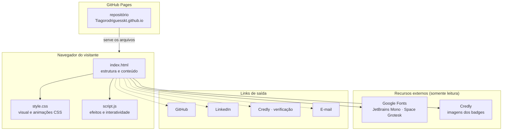

O site é **100% estático**: não há servidor, banco de dados nem coleta de dados do visitante. O GitHub Pages apenas entrega os três arquivos, e tudo roda no navegador.

### 4.3 Módulos do `script.js`

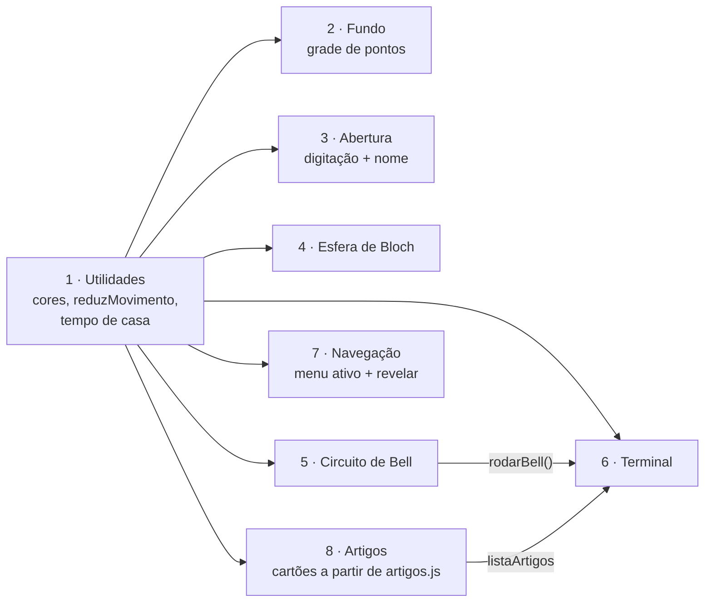

Cada módulo é uma **função que se executa sozinha** (IIFE), com suas próprias variáveis. Assim, um efeito não interfere no outro. As únicas ligações entre módulos são a função `rodarBell()`, que o terminal usa no comando `bell`, e a lista `listaArtigos`, que o terminal usa no comando `artigos`.

---

## 5. Estrutura da página

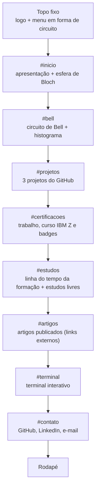

O menu mapeia cada seção para uma porta quântica:

| Porta | Seção | Por quê |
|---|---|---|
| `[H]` | início | a Hadamard "inicia" a superposição |
| `[CX]` | bell | a CNOT é a porta que cria o emaranhamento |
| `[X]` | projetos | porta de ação, "virar o bit" |
| `[Y]` | mainframe | — |
| `[Rz]` | estudos | rotação contínua: aprendizado em andamento |
| `[T]` | artigos | a porta T é a "fase fina" (π/4): cada artigo é um pequeno passo |
| `[M]` | contato | medição: o momento de "colapsar" em uma conversa |

---

## 6. Módulos do JavaScript

### 6.1 Utilidades

- `reduzMovimento`: lê a preferência do sistema `prefers-reduced-motion`.
- `corCSS(nome)`: lê as cores do `:root` do CSS, para os canvas usarem a mesma paleta.
- `espera(ms)`: pausa assíncrona usada nas animações.
- **Tempo de casa:** qualquer elemento com `data-desde="AAAA-MM"` recebe automaticamente o número de anos (usado no cartão da CSU Digital).

### 6.2 Fundo que reage ao mouse

Uma grade de pontos espaçados de 30 px, redesenhada a cada quadro. Cada ponto é deslocado por duas fontes: o **pacote de onda** em volta do mouse e as **ondas circulares** dos cliques (detalhes na [seção 7.5](#75-fundo-pacote-de-onda)). Pontos com mais "energia" ganham a cor de destaque.

### 6.3 Abertura

1. As letras de "Tiago Rodrigues" ficam trocando entre símbolos (`ψ φ θ α β ℏ ∂ ∑ ...`). Cada palavra é um bloco que nunca se quebra no meio, então em telas estreitas o sobrenome desce para a linha de baixo.
2. Ao mesmo tempo, o comando `python3 -m tiago --estado` é digitado letra por letra.
3. Quando a digitação termina, cada letra "colapsa" no seu valor real, uma de cada vez. Para trocar o nome, basta mudar o texto do `<h1 id="nome">` no `index.html`.
4. A largura de cada letra é fixada antes, para o nome não tremer durante o efeito.

### 6.4 Esfera de Bloch

O estado do qubit é guardado como um vetor $(x, y, z)$ de comprimento 1. Cada porta é uma **rotação** desse vetor, animada em 750 ms. A esfera é projetada em 2D a cada quadro, levando em conta a rotação da câmera (o visitante pode arrastar).

### 6.5 Circuito de Bell

Ao clicar em **rodar**, uma animação CSS percorre os fios e acende as portas na ordem H → CNOT → M. Depois, o JavaScript sorteia os resultados de 100, 1 000 ou 10 000 medições, monta o histograma e mostra o resultado no formato de dicionário do Qiskit.

### 6.6 Terminal

Um interpretador de comandos simples: o texto digitado é separado em `comando` e `argumentos`, e o comando é procurado num objeto `COMANDOS`. Todas as saídas usam `textContent`, nunca `innerHTML`, então nada que o visitante digita é interpretado como código.

| Comando | O que faz |
|---|---|
| `help` | lista os comandos |
| `whoami` | apresentação curta |
| `ls` · `cd <seção>` | lista e navega pelas seções |
| `cat bloch.py` · `cat bell.qasm` | mostra os códigos de exemplo |
| `projetos` · `certificados` · `formacao` · `artigos` | resumos das seções |
| `contato` · `github` · `linkedin` | links |
| `qubit` | prepara $\|+\rangle$ e mede |
| `bell` | rola até o circuito e executa |
| `gato` | homenagem a Schrödinger |
| `date` · `echo` · `clear` | utilitários |

As setas ↑ e ↓ navegam pelo histórico de comandos.

### 6.7 Artigos

Os artigos **não ficam hospedados no site**: cada cartão leva à plataforma onde o artigo foi publicado (Zenodo, arXiv, Google Acadêmico...).
A lista fica num arquivo separado, `artigos.js`, para que publicar um artigo não exija mexer no HTML.

- Os artigos são ordenados do mais novo para o mais antigo e numerados (`01`, `02`...).
- Se o link for um DOI (`https://doi.org/...`), o identificador aparece no cartão.
- Só são aceitos links que começam com `https://`; qualquer outro é ignorado. Todos os textos entram com `textContent`, nunca como HTML.
- Com a lista vazia, a seção mostra uma janela de terminal com `total 0` e o aviso "primeiro artigo em breve".
- Se `PERFIL_ACADEMICO.link` estiver preenchido, aparece no fim da seção um link para o perfil completo.

### 6.8 Navegação

Dois `IntersectionObserver`:

- um acende no menu a porta da seção que está no meio da tela;
- outro faz cada seção aparecer suavemente na primeira vez que entra na tela.

---

## 7. A física por trás dos efeitos

### 7.1 Estado de um qubit e a esfera de Bloch

Todo estado puro de um qubit pode ser escrito como

$$|\psi\rangle = \cos\frac{\theta}{2}\,|0\rangle + e^{i\varphi}\sin\frac{\theta}{2}\,|1\rangle$$

e corresponde a um ponto na superfície de uma esfera de raio 1:

$$\vec r = (\sin\theta\cos\varphi,\ \sin\theta\sin\varphi,\ \cos\theta)$$

O painel ao lado da esfera mostra, em tempo real, $\theta$, $\varphi$, as amplitudes $\alpha = \cos(\theta/2)$ e $\beta = \sin(\theta/2)\,e^{i\varphi}$, e as probabilidades de medição.

### 7.2 Portas quânticas como rotações

Toda porta de um qubit é uma rotação da esfera em torno de um eixo $\hat n$ por um ângulo $\alpha$. A rotação é calculada com a **fórmula de Rodrigues**:

$$\vec v' = \vec v\cos\alpha + (\hat n \times \vec v)\sin\alpha + \hat n\,(\hat n\cdot\vec v)(1-\cos\alpha)$$

| Porta | Eixo $\hat n$ | Ângulo | Efeito |
|---|---|---|---|
| H | $(1, 0, 1)/\sqrt2$ | $\pi$ | troca $\|0\rangle \leftrightarrow \|+\rangle$ |
| X | $(1, 0, 0)$ | $\pi$ | troca $\|0\rangle \leftrightarrow \|1\rangle$ |
| Y | $(0, 1, 0)$ | $\pi$ | inverte bit e fase |
| Z | $(0, 0, 1)$ | $\pi$ | inverte a fase |
| S | $(0, 0, 1)$ | $\pi/2$ | soma 90° à fase |
| T | $(0, 0, 1)$ | $\pi/4$ | soma 45° à fase |

Durante a animação, o ângulo cresce de $0$ até $\alpha$ com uma curva de suavização (*ease-in-out* cúbica), e a ponta do vetor deixa um rastro.

### 7.3 Medição

A probabilidade de medir $|0\rangle$ é

$$P(0) = \cos^2\frac{\theta}{2} = \frac{1 + z}{2}$$

O botão **medir** sorteia um número entre 0 e 1. Se for menor que $P(0)$, o estado colapsa para o polo norte $|0\rangle$; senão, para o polo sul $|1\rangle$. O vetor gira pelo menor caminho até o polo, usando como eixo o produto vetorial $\vec v \times \overrightarrow{\text{alvo}}$.

### 7.4 Estado de Bell e ruído

Depois da porta H em $q_0$ e da CNOT, o estado dos dois qubits é

$$|\Phi^+\rangle = \frac{|00\rangle + |11\rangle}{\sqrt2}$$

Ao medir, só aparecem `00` ou `11`, cada um com 50% de chance: os qubits estão **emaranhados**. Cada *shot* é simulado sorteando um único bit compartilhado pelos dois qubits.

O **ruído** opcional simula erros de leitura: cada bit medido é invertido com probabilidade $p = 0{,}02$. Com isso:

$$P(01) = P(10) = p(1-p) \approx 1{,}96\%$$

$$P(\text{concordância}) = (1-p)^2 + p^2 \approx 96{,}04\%$$

Na prática, com 1 000 shots, a concordância fica perto de 96%, como na captura abaixo.

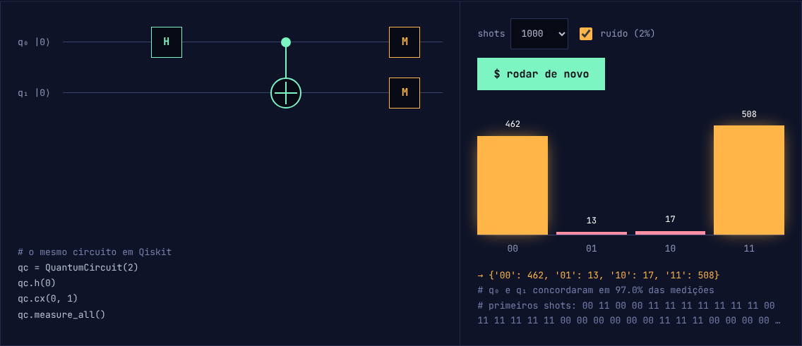

### 7.5 Fundo: pacote de onda

Cada ponto da grade, a uma distância $d$ do mouse, é empurrado radialmente por

$$\Delta(d, t) = A\,e^{-d^2/2\sigma^2}\,\sin(kd - \omega t)$$

com $A = 8$ px, $\sigma = 150$ px, $k = 0{,}06$ rad/px e $\omega = 0{,}005$ rad/ms. É uma onda que oscila dentro de um envelope gaussiano, a mesma forma de um pacote de onda da mecânica quântica.

Cada clique cria uma frente de onda circular que se expande a 0,45 px/ms e perde força em 2,6 s.

---

## 8. Fluxogramas

### 8.1 Carregamento da página

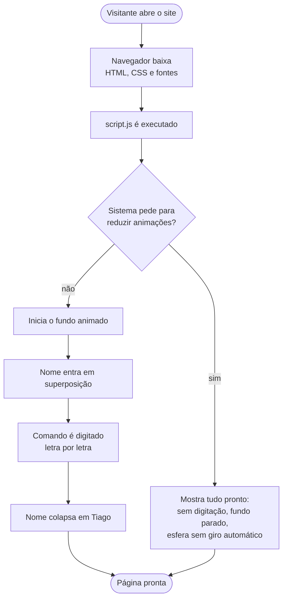

### 8.2 Esfera de Bloch: aplicar porta ou medir

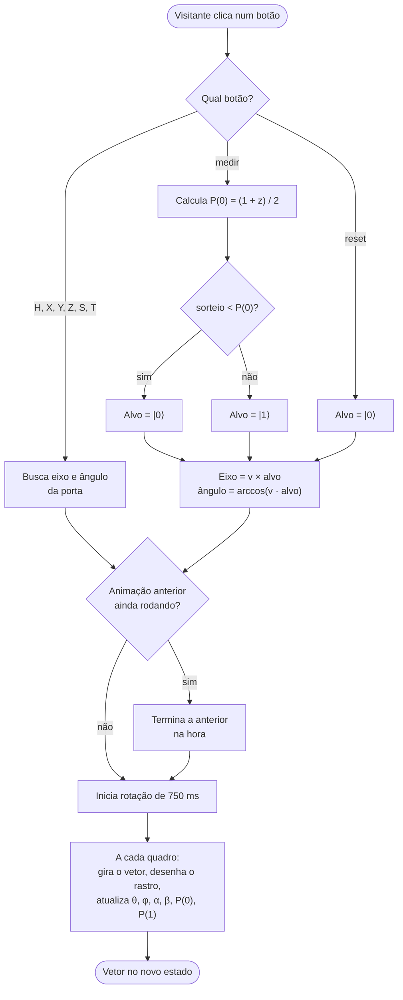

### 8.3 Circuito de Bell

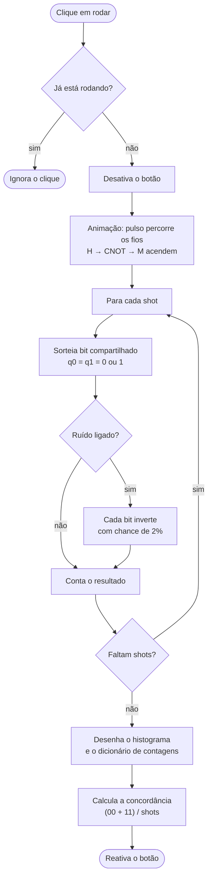

### 8.4 Terminal

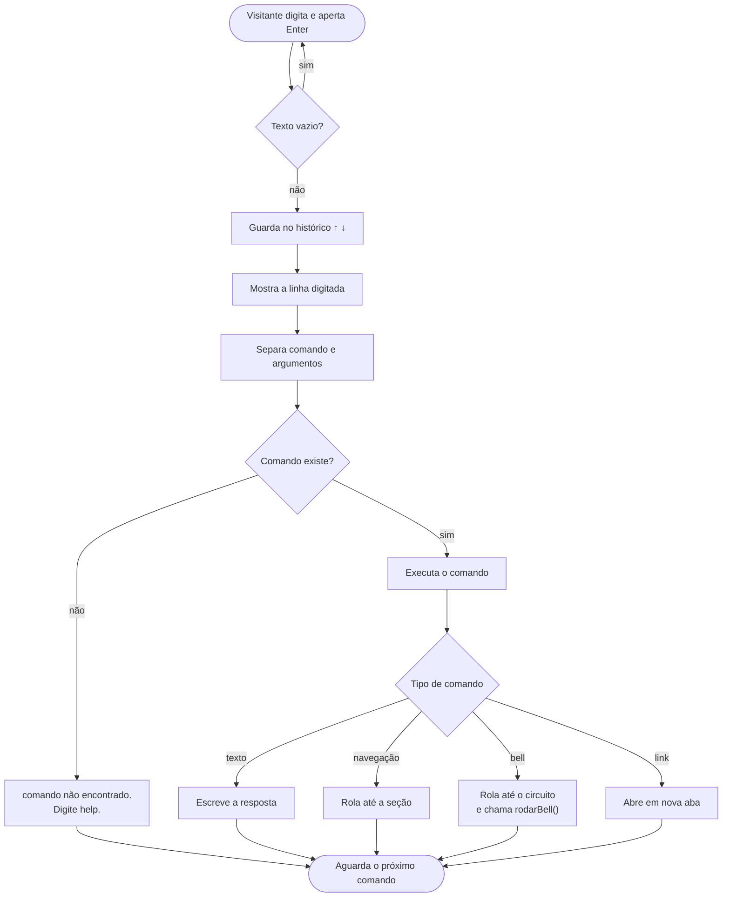

### 8.5 Diagrama de sequência: aplicando uma porta

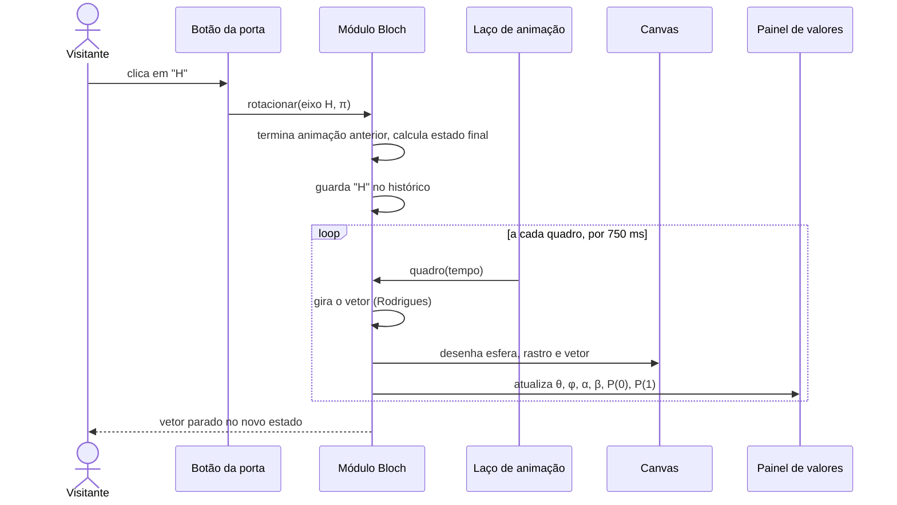

---

## 9. Design system

### 9.1 Cores

Todas definidas em `:root`, no topo do `style.css`.

| Variável | Valor | Uso |
|---|---|---|
| `--fundo` | `#080B16` | fundo da página |
| `--painel` | `#0E1328` | janelas e cartões |
| `--borda` | `#222A50` | bordas |
| `--fio` / `--fio-claro` | `#2A3157` / `#3A4270` | fios do circuito e pontos do fundo |
| `--texto` | `#B9C0D6` | texto comum |
| `--forte` | `#FFFFFF` | títulos |
| `--suave` / `--apagado` | `#9097BA` / `#7780AC` | textos secundários e comentários |
| `--a1` | `#7CF5C2` | destaque **"código"**: portas, vetor de estado, botões |
| `--a2` | `#FFB547` | destaque **"medição"**: resultados, contato, certificações |
| `--erro` | `#FF8FA3` | erros (01 e 10 no Bell, comandos inválidos) |

Os textos secundários foram escolhidos para ter contraste de pelo menos 4,5:1 com o fundo, o mínimo recomendado pelas diretrizes de acessibilidade (WCAG AA).

### 9.2 Tipografia

| Fonte | Uso |
|---|---|
| **JetBrains Mono** | corpo do texto, menu, terminal, código |
| **Space Grotesk** | nome, títulos de seção e de cartão |

### 9.3 Componentes

| Componente | Classe | Descrição |
|---|---|---|
| Janela | `.janela` + `.janela-barra` | painel com barra de título e três bolinhas, imitando um terminal |
| Porta do menu | `.porta` | link com borda que acende quando a seção está visível |
| Botão | `.btn`, `.btn-primario`, `.btn-medida` | altura mínima de 44 px (área de toque confortável) |
| Cartão | `.cartao` + `.cartao-topo` + `.cartao-corpo` | projetos, estudos, trabalho |
| Badge | `.cert`, `.cert-grande` | imagem do Credly + nome + emissor |
| Etapa | `.etapa`, `.etapa.futura` | nó da linha do tempo da formação |

---

## 10. Responsividade

| Largura da tela | O que muda |
|---|---|
| acima de 960 px | layout completo: Bell em duas colunas, cartões em 3 ou 4 colunas |
| até 960 px | Bell em uma coluna; cartões e formação em 2 colunas |
| até 720 px | menu deixa de ser fixo; linha do tempo fica vertical; esfera ocupa a largura |
| até 560 px | todos os cartões em uma coluna |

O circuito de Bell, que precisa de largura mínima para os fios ficarem legíveis, ganha rolagem horizontal própria em telas pequenas, sem quebrar o resto da página.

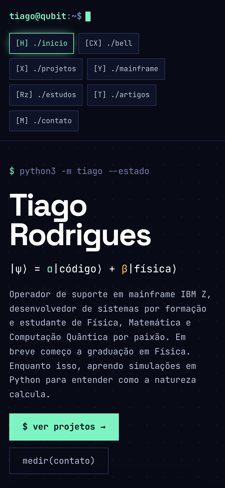

---

## 11. Acessibilidade e desempenho

### Acessibilidade

- **Movimento reduzido:** quem ativa essa opção no sistema vê o site completo, sem animações.
- **Teclado:** todos os botões e links são navegáveis com Tab; a esfera de Bloch gira com as setas do teclado.
- **Leitores de tela:** a esfera tem descrição (`aria-label`); os resultados da esfera, do Bell e do terminal são anunciados (`aria-live`); elementos decorativos são escondidos (`aria-hidden`).
- **Foco visível** em todos os elementos interativos.
- **Contraste** mínimo de 4,5:1 nos textos.

### Desempenho

- **Zero bibliotecas:** só três arquivos próprios.
- A esfera **só é desenhada quando está visível** na tela (`IntersectionObserver`), economizando bateria.
- Os canvas respeitam a densidade de pixels da tela, limitada a 2× para não pesar em telas muito densas.
- As imagens dos badges carregam só quando a seção se aproxima (`loading="lazy"`).
- O navegador pausa as animações sozinho quando a aba fica em segundo plano (`requestAnimationFrame`).

---

## 12. Testes

Os testes foram feitos com um navegador Chromium automatizado (Playwright), simulando um visitante.

| Teste | Resultado |
|---|---|
| Sintaxe do `script.js` (`node --check`) | ✅ sem erros |
| Erros no console ao carregar e usar o site | ✅ nenhum |
| Aplicar portas H e S na esfera | ✅ vetor e valores corretos |
| Medir o qubit | ✅ colapsa no polo sorteado, com a probabilidade exibida |
| Rodar Bell sem ruído | ✅ apenas 00 e 11, concordância de 100% |
| Rodar Bell com ruído de 2% | ✅ 01 e 10 aparecem; concordância perto de 96% |
| Comandos do terminal | ✅ `help`, `cat`, `formacao`, `qubit` e outros |
| Desktop (1366 × 900) | ✅ layout completo |
| Celular (390 × 844) | ✅ menu, esfera e linha do tempo adaptados |

**Bug encontrado e corrigido:** o resultado do Bell aparecia fora de ordem (`'10'` antes de `'00'`). O motivo é que o JavaScript coloca primeiro as chaves de objeto que parecem números inteiros (`'10'`, `'11'`), e só depois as outras (`'00'`, `'01'`). A correção foi percorrer uma lista com a ordem fixa `['00', '01', '10', '11']`.

---

## 13. Manutenção: como alterar o site

### Mudar as cores

Edite as variáveis `--a1` e `--a2` no topo do `style.css`. O site inteiro, incluindo os canvas, usa essas variáveis.

### Adicionar um projeto

No `index.html`, dentro de `<section id="projetos">`, copie um bloco `<article class="cartao">` e troque título, descrição, tags e link. Para manter a grade alinhada, use múltiplos de 3 cartões.

### Adicionar um badge do Credly

1. Abra `https://www.credly.com/users/tiago-r-c-goncalves/badges.json`.
2. Copie o `id` do badge e o `image_url` do `badge_template`.
3. No `index.html`, copie um bloco `<a class="cert">` e troque o link (`https://www.credly.com/badges/ID`), a imagem, o nome e a data.

### Atualizar a formação

Quando a graduação em Física começar, na seção `#estudos`, troque `início em 2027` por `em andamento`. Quando terminar, tire a classe `futura` do `<li>` e troque `ψ` por `✓`.

### Publicar um artigo

1. Publique o artigo na plataforma escolhida (por exemplo, o Zenodo, que gera um DOI).
2. Abra o `artigos.js`, copie o modelo comentado, apague as `//` do começo das linhas e preencha:

```js
{
  titulo: 'Título do artigo',
  data:   '2027-03',
  resumo: 'Uma ou duas frases dizendo do que o artigo trata.',
  tags:   ['computação quântica', 'python'],
  onde:   'Zenodo',
  link:   'https://doi.org/10.5281/zenodo.0000000',
},
```

3. Quando tiver um perfil acadêmico, preencha também `PERFIL_ACADEMICO.link` no mesmo arquivo.
4. Publique com `git add`, `git commit` e `git push`. A seção e o comando `artigos` do terminal se atualizam sozinhos.

### Criar um comando no terminal

No `script.js`, bloco 6, adicione uma função ao objeto `COMANDOS` e uma linha no texto do `help`:

```js
meucomando(args) {
  escrever('olá do meu comando!', 'ok');
},
```

Classes disponíveis para `escrever`: `'ok'` (verde), `'med'` (âmbar), `'erro'` (vermelho) ou nenhuma (texto comum).

---

## 14. Próximos passos

- [ ] Publicar no GitHub Pages, substituindo o portfólio antigo
- [ ] Escrever a versão em Python (NumPy) da esfera de Bloch e do circuito de Bell, como projeto próprio
- [ ] Criar páginas individuais para cada projeto, com gráficos e explicações
- [ ] Adicionar uma versão em inglês do site
- [ ] Atualizar a formação quando a graduação em Física começar (2027)
- [ ] Publicar o primeiro artigo e preencher o `artigos.js`
- [ ] Incluir novos badges conforme o curso IBM Z avança

---

## 15. Histórico de versões

| Versão | Data | Mudanças |
|---|---|---|
| 0.1 | out 2026 | Quatro direções de estilo; escolha da direção D |
| 0.2 | out 2026 | Primeira versão: esfera de Bloch, Bell, fundo, terminal |
| 0.3 | out 2026 | Projetos reais do GitHub |
| 0.4 | out 2026 | Seção Mainframe: trabalho na CSU Digital, curso IBM Z e badges do Credly |
| 0.5 | out 2026 | LinkedIn, e-mail e linha do tempo da formação |
| 1.0 | out 2026 | Correção da ordem no resultado do Bell; documentação técnica |
| **1.1** | out 2026 | Seção Artigos (lista em `artigos.js`, links externos, DOI, comando `artigos`); menu mais compacto |
